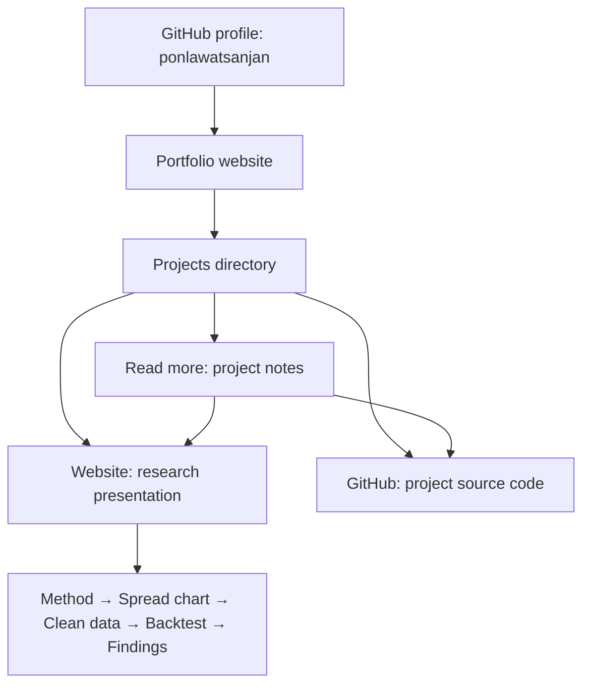

# How the portfolio connects to projects

The portfolio introduces Ponlawat Sanjan and provides a directory of projects. Each project has its own repository and can have its own website. Visitors start with the portfolio, choose a project, and open its presentation or source code.

## Visitor journey



The GitHub profile, portfolio website and research website are separate pages. A repository stores the source files; GitHub Pages publishes those files as a website. Pushing source files alone does not enable Pages for a new repository.

## Where everything lives

| Part | Purpose | Location |
| --- | --- | --- |
| GitHub profile | Your account and repositories | [ponlawatsanjan](https://github.com/ponlawatsanjan) |
| Portfolio repository | Source for your personal portfolio | [Portfolio](https://github.com/ponlawatsanjan/Portfolio) |
| Portfolio website | Your introduction and project directory | Intended address: `https://ponlawatsanjan.github.io/Portfolio/`; publishing still needs to be enabled |
| Research repository | Source for the calendar-spread presentation | [can-btc-calendar-spread-arbitrage-make-a-profit](https://github.com/ponlawatsanjan/can-btc-calendar-spread-arbitrage-make-a-profit) |
| Research website | The published interactive presentation | [Can BTC Calendar Spread Arbitrage Make a Profit?](https://ponlawatsanjan.github.io/can-btc-calendar-spread-arbitrage-make-a-profit/) |

The project links are already configured in the portfolio source. Once the portfolio is published, visitors can follow them from its project directory. Adding a link to the portfolio on your GitHub profile is a separate step.

## Portfolio structure

```text
Portfolio/
├── index.html               Introduction, projects, about and contact
├── style.css                Colors, typography and responsive layout
├── app.js                   Project entries, search, filters and details
├── assets/                  Favicon, local font and font license
├── preview-server.cjs       Optional local preview server
├── package.json             npm run dev command
├── README.md                Setup and editing guide
└── PROFILE_AND_PROJECTS.md  This guide
```

`index.html` provides the page structure. `app.js` builds the project cards from the `projects` array. Search and category filters operate on those entries. The Read more button opens a dialog with longer notes and the same website/source links.

## How a project link works

The calendar-spread entry in `app.js` includes:

```javascript
{
  id: 'spread',
  title: 'Can BTC Calendar Spread Arbitrage Make a Profit?',
  category: 'research',
  status: 'Research in progress',
  website: 'https://ponlawatsanjan.github.io/can-btc-calendar-spread-arbitrage-make-a-profit/',
  repository: 'https://github.com/ponlawatsanjan/can-btc-calendar-spread-arbitrage-make-a-profit'
  // Other fields supply the description, tags, icon, notes and notice.
}
```

- **Website** opens the published presentation in a new tab.
- **GitHub** opens the source repository in a new tab.
- **Read more** opens project notes inside the portfolio, including both links.

An HTTPS address makes its link visible. Setting `website` or `repository` to `null` hides that action. The portfolio does not copy or embed the research website; it links to it.

## Research website structure

The separate research repository publishes only its `website/` folder:

```text
can-btc-calendar-spread-arbitrage-make-a-profit/
├── README.md
├── .github/workflows/pages.yml  Deploy website/ to GitHub Pages
└── website/
    ├── index.html              Presentation shell
    ├── app.js                  Pages and navigation
    ├── style.css, reader.css,
    │   modern.css              Presentation styling
    ├── snapshot.html           Interactive chart page
    ├── snapshot.js             Browser chart interactions
    ├── data/spreads.json       Saved matched trade observations
    └── vendor/plotly.min.js    Chart library
```

The presentation explains the matching method, then shows real trade-based spreads across 25 expiry pairs. The clean-data and backtest pages remain illustrative drafts. Profitability has not been established.

Visitors need only a browser. The chart uses prepared data with zoom, hover, date selection and pair visibility. It does not run Python or read raw tick CSVs. Zoom enlarges saved overview points rather than fetching omitted trades. Python tools and full raw data remain on the researcher's computer, outside the repository's current files.

## What to update when work changes

| Change | Where to edit | What visitors see after publication |
| --- | --- | --- |
| Your introduction or about section | Portfolio `index.html` | Updated profile text |
| Project title, description, status or links | Portfolio `app.js` | Updated project card and details |
| Research explanation or presentation pages | Research `website/app.js` | Updated project presentation |
| Prepared spread observations | Research `website/data/spreads.json` | Updated chart |
| A new project | Add a complete entry to Portfolio `projects` in `app.js` | Another searchable project card |

Push changes to the repository that owns the edited files. Research website changes deploy automatically through its Pages workflow. Portfolio changes need their own Pages publishing configuration. Updating one site does not update the other; the link continues to work as long as the project URL stays the same.
